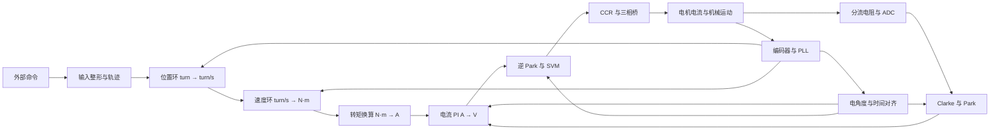
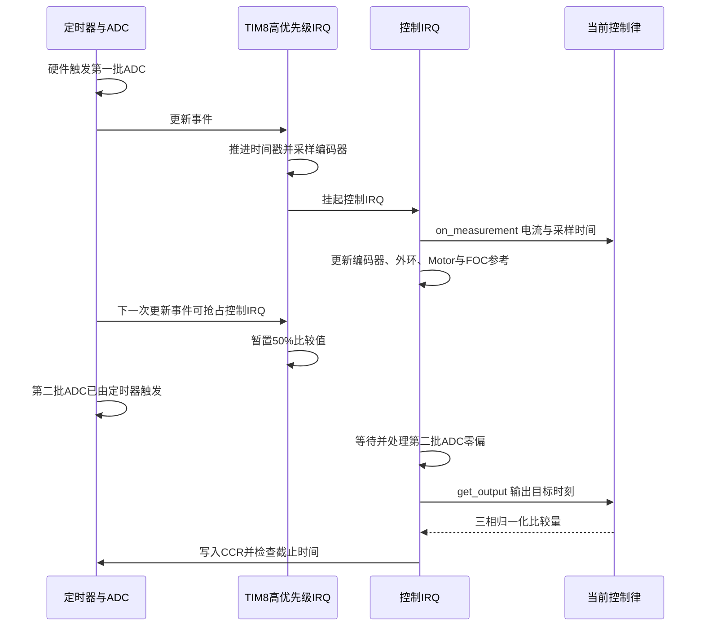

# ODrive 电机控制源码教材

这组 CodeTour 的学习目标是：看到一行电机控制代码，能说明它对应的物理问题、数学关系、时间假设和工程取舍。每节均包含「物理模型与推导」「对照源码」「容易忽略的工程考虑」「自测与参考答案」，原有个人补充保存在对应步骤末尾。

本教材按当前仓库源码编写，硬件数值以 `Board/v3`、当前 `tup.config` 中的 `v3.6-56V` 为依据。主要推导针对正弦、表贴式永磁同步电机的有感控制路径；ACIM、GIMBAL、无感和双编码器等特殊路径单独说明。电机实例中的 R、L、Kt、惯量和母线电压均为教学示例，不能据此认定实际设备参数。

## 怎样读

从 **00 教材地图与学习方法** 开始，按编号继续。第一次阅读先建立各级物理含义；第二次重点重读 33、44、50、51，把时间戳、采样窗和坐标变换放到同一张纸上。

CodeTour 文件路径以 Firmware 工作区为根，适合当前 `ODrive_Workspace.code-workspace` 中的 Firmware 文件夹。章节标题带编号，`nextTour` 已按顺序连接。行号以整理时源码为准；以后修改源码导致跳转漂移，可用步骤中提到的符号重新定位。

|章|内容|学完应能回答|
|---|---|---|
|[00](00-教材地图与学习方法.tour)|物理、软件与时间三张地图|命令怎样变为机械转矩？|
|[01](01-从绕组到机械运动.tour)|RL、磁链、转矩、惯量与单位|为什么电压不能直接保证转矩？|
|[10](10-上电顺序与确定性运行.tour)|初始化、配置、线程、中断|为什么采样先于闭环状态启动？|
|[20](20-状态机与无突变闭环切换.tour)|校准依赖、接线、使能与退出|闭环切换为何对齐参考并清积分？|
|[30](30-电流测量硬件与量程取舍.tour)|分流、增益、ADC、饱和与零偏|量程与电流分辨率怎样相互制约？|
|[31](31-电机校准流程与实验条件.tour)|R/L 校准实验的组织|校准成功究竟说明了什么？|
|[32](32-一拍控制的完整时间轴.tour)|测量、参考更新、零偏与 PWM|谁在何时产生了哪份数据？|
|[33](33-采样窗口谐波混叠与数字延迟.tour)|同步采样、开关纹波、混叠、延迟|为什么采样时刻属于控制律的一部分？|
|[40](40-通信命令与可观测性.tour)|异步命令和观测通道|上位机看到的时间与采样时间相同吗？|
|[41](41-控制结构与信号的新鲜度.tour)|端口、依赖顺序、控制律与生命周期|为何旧值比空值更容易隐藏故障？|
|[42](42-位置速度转矩级联控制.tour)|机械模型、级联 PI、限幅与齿槽补偿|每一级增益放大什么误差？|
|[43](43-输入整形轨迹与前馈.tour)|斜坡、二阶滤波、梯形轨迹和惯量|轨迹连续与实际跟踪分别由谁保证？|
|[44](44-编码器PLL与电角度标定.tour)|量化、PLL、插值、偏置和无感|空间错位与时间错位如何区分？|
|[50](50-FOC电流环与空间矢量调制.tour)|Clarke、Park、PI、逆 Park、SVM|电流误差最终怎样成为 CCR？|
|[51](51-辨识公式与电流PI离散实现.tour)|实验激励、同步符号和 PI 推导|为何移植后不能照抄辨识符号和带宽？|
|[52](52-功率回生与分层保护.tour)|功率、制动、热限流和 spinout|减速能量去了哪里？|
|[53](53-综合推理与故障分析练习.tour)|按证据排查的综合题|怎样证明或推翻自己的解释？|

## 三张需要亲手画出的图

### 一、带单位的控制通路



图示为典型有感 PMSM；具体模式可以跳过外环，或替换角度来源。FOC 还受到母线电压、电流圆、温度和数据有效性等约束。

### 二、一拍的软件执行顺序



这是一张软件处理顺序图，**ADC 采样由 TRGO 触发，不由图中的函数调用软件启动**。双轴 ADC 触发还存在偏移，图没有画出每路转换的精确时间。电流采样保持、转换完成、中断到达、寄存器读取、CCR 预装载生效、输出有效区间中心，都不是同一个时刻。

### 三、按时间戳表达的物理时间轴

记 `t` 为控制 IRQ 保存的 TIM8 时间戳：

|参数|本配置计算结果|来源|
|---|---|---|
|TIM1/8 时钟|168 MHz|`Board/v3/Inc/main.h`|
|ARR|3500|同上|
|重复计数器 RCR|2|同上|
|PWM 载波周期|约 41.667 μs，即 24 kHz|`2×ARR / 时钟`|
|相邻更新事件 H|62.5 μs|`ARR×(RCR+1) / 时钟`|
|控制周期 Ts|125 μs，即 8 kHz|`2H`|
|轴间时间偏移 δ|约 9.655 μs|`(3500/2−128)/168MHz`|
|v3.6 分流电阻|500 μΩ|`Board/v3/Inc/board.h`|

|数据或目标|M0|M1|
|---|---|---|
|第一批电流采样时间戳|t−δ|t|
|FOC 参考时间戳|t|t|
|第二批零偏采样时间戳|t+H−δ|t+H|
|输出有效区间中心目标|t+3H−δ|t+3H|

`PhaseControlLaw::get_output` 的接口注释将输出时间戳定义为**输出有效时间区间的中心**。因此 `3H=187.5μs` 是样本到该输出中心目标的时间关系；不能把它误写成 CPU 运算耗时、CCR 生效前的固定等待时间，或未经测量的全环路纯延迟。

## 公式与量纲速查

|关系|含义与适用范围|
|---|---|
|`v=Ri+L·di/dt+e`|线性等效绕组模型；真实对象可随温度、电流变化|
|`τe=L/R`|静止简化 RL 时间常数|
|`ωm=2πv`，`ωe=pωm`|v 用 turn/s，ω 用 rad/s，p 是极对数|
|`T≈Kt·Iq`|永磁、正弦、Id≈0，且 Kt 电流约定一致|
|`T=2πJ·a`|a 用 turn/s²；对应 `config.inertia≈2πJ`|
|`Iq上限=sqrt(Ilim²−Id²)`|该实现优先保留 Id 后的电流圆约束|
|`Kp=ωcL`，`Ki=ωcR`|理想 RL 电流 PI；ωc 按 s⁻¹ 使用，Hz 数值为 ωc/(2π)|
|`积分下一拍=积分本拍+Ki·Ts·e`|Ki 不是已经乘过采样周期的离散系数|
|`Iα=Ia`，`Iβ=(Ib−Ic)/√3`|此仓库的幅值不变 Clarke|
|`Id=cosθ Iα+sinθ Iβ`|Park 的 d 分量|
|`Iq=cosθ Iβ−sinθ Iα`|Park 的 q 分量，注意负号|
|`P≈3/2(VdId+VqIq)`|与上述幅值约定配套，忽略桥损耗|
|`Ibus≈mdId+mqIq`|本实现的母线电流估计，非独立传感器|
|`电流模式电压上限=0.8Vbus/√3`|由当前调制限幅分支推导，非所有模式通用规则|
|`Δθ≈ωeΔt`|短时恒速相位外推近似|
|`延迟相位≈−360fTd` 度|纯延迟在扰动频率 f 处的相位；不等于全部离散系统模型|
|`滤波残差=(1−k)^N≈exp(−t/τ)`|小步长一阶滤波近似|

## 怎样识别经验设计，而不是替作者编理由

以三层证据写笔记：

1. **源码事实**：写出分支、参数和执行顺序。例如饱和时积分乘 `0.99`。
2. **模型推导**：写假设、量纲和计算。例如 8 kHz 下反复乘 `0.99` 的等效衰减时间常数约 12.44 ms；只有处于该分支持续执行时才适用。
3. **待验证动机**：指出缺失的证据。例如作者为什么选择这个衰减速度，而不是 5 ms 或 30 ms，需要设计资料或实验。

几个必须保持边界的例子：

|代码细节|可以确认|不能直接断言|
|---|---|---|
|`TIM1_INIT_COUNT` 中减去 128|存在约 0.762 μs 的额外时间偏移；源码留有 TODO|它专门用于消除某次谐波，或恰好等于某个模拟延迟|
|调制系数 `0.80`|电流模式限制电压矢量幅值并留下裕量|唯一目的就是某个 ADC 采样窗口|
|偏置上限 10%、等待 7.5τ|分别约束幅度与初值收敛|任意板卡、温度和噪声条件下都足够|
|电感辨识的 `−sign`|与当前测量/输出流水线配合|换平台或调用频率后符号仍可不变|
|三相和为零|重建 A 时已强制满足此关系|它能独立证明原始 B/C 测量没有误差|

还要核对**注释与可执行代码是否一致**：

- `motor.cpp` 中电流检查附近有“校准时禁用检查”的旧注释，但当前紧随其后的 `if (Inorm_sq > SQ(Itrip))` 并没有相应模式排除条件。不能只读注释就认为校准绕过这项检查。
- `apply_pwm_timings` 中一个基于 TIM 更新标志的截止检查块已被注释；当前板级控制 IRQ 末尾还有另一个实际执行的截止检查。两者不能混为一谈。
- 某些接口注释称回调处于高优先级上下文，但本板实际调用位于 `ControlLoop_IRQHandler`，优先级为 5，TIM8 更新 IRQ 为 0。解释抢占关系应以当前调用路径和 NVIC 配置为准。
- `board.h` 相邻时间偏移注释与双轴调用表达式存在容易误读之处，本教材的时间表按 `ControlLoop_IRQHandler` 实际传参整理。

这类矛盾本身就是学习工程源码的重要材料：模型、注释、代码和硬件证据需要互相校验。

## 三组纸上算例

### 采样混叠

设 `i(t)=I平均+A sin(2πfrt+φ)`，`fs=8kHz`。当 `fr=24kHz` 时，离散纹波为 `A sinφ`，变成看似直流的误差；当 `fr=24.1kHz` 时可折叠到 `100Hz`。这不是说真实 PWM 纹波只有一条正弦，而是用最简单模型说明采样相位和混叠。

同步采样能利用确定性的纹波形状选取代表性样本，但**固定相位不自动等于平均值，也不等于所有谐波都被消除**。采样后再低通，无法分辨已经折成直流的分量。参见 [imperix：功率电子采样技术](https://imperix.com/doc/help/sampling-techniques-for-power-electronics)。

### 连续 PI 到离散执行

教学参数 `R=0.1Ω`、`L=100μH`、`ωc=1000s⁻¹`：

```text
Kp = ωcL = 0.1 V/A
Ki = ωcR = 100 V/(A·s)
Ts = 125 μs
每拍积分系数 KiTs = 0.0125 V/A
理想闭环时间常数 = 1/ωc = 1 ms
理想闭环 −3dB 频率 = ωc/(2π) ≈ 159 Hz
```

理想极零相消没有包含数字延迟、采样保持、旋转耦合或饱和。1 kHz 处若存在 187.5 μs 的纯延迟，其相位贡献约 −67.5°；这只是说明延迟量级，不能据此宣称已经算出此固件完整的相位裕量。

### 区分周期扰动

7 极对、600 rpm 时，机械频率 10 Hz、电频率 70 Hz，典型同步 dq 六倍电频率为 420 Hz。齿槽与槽极结构相关，PWM 纹波则围绕 24 kHz 载波及其边带。实际频谱可能包含混叠；一个峰值不能独立证明根因。

每次观察先记录：原始采样率、报告滤波、遥测频率、机械转速、极对数、角度定义和共同时间基准。然后再讨论“几次谐波”。测量误差、死区与转矩纹波的关系可扩展阅读 [Analog Devices：电机电流环非理想因素](https://www.analog.com/en/resources/technical-articles/impact-of-nonideal-effects-in-a-motor-drive-current-loop.html)。

## 外部资料与本仓库的关系

本教材的固件行为以本地源码为准。外部资料用于解释通用机理，不用新版产品行为替代此旧版源码：

- [ST UM1052，电流采样章节](https://www.st.com.cn/resource/en/user_manual/um1052-stm32f-pmsm-singledual-foc-sdk-v43-stmicroelectronics.pdf)：了解低侧采样窗、死区与开关后建立时间；它是 ST 的实现说明，不是本仓库 128 tick 偏移的设计证明。
- [imperix，采样技术](https://imperix.com/doc/help/sampling-techniques-for-power-electronics)：理解同步采样与抗混叠。
- [Analog Devices，电流环非理想因素](https://www.analog.com/en/resources/technical-articles/impact-of-nonideal-effects-in-a-motor-drive-current-loop.html)：理解测量误差与转矩纹波。

## 每章结束后的笔记模板

```text
我正在解释的代码与信号：
变量单位、输入来源和有效条件：
这份数据代表的物理时刻：
模型和简化假设：
公式与一个数值代入：
这项设计试图解决的问题：
参数改变可能牺牲什么：
哪些结论来自源码，哪些是推导，哪些仍是猜测：
什么观测能推翻我的解释：
```

以“能推导、能解释失败边界、能提出验证证据”为一章掌握的标准。53 章的综合题可用于检查自己是否已经跨过单纯理解语法的阶段。
